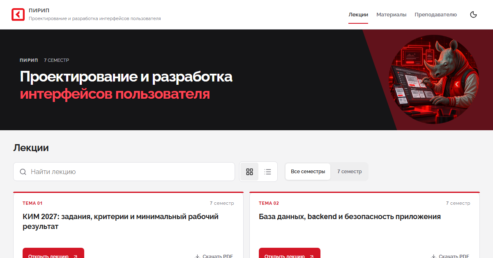

# Разработка и сопровождение курса ПИРИП

Пять переработанных лекций на общем шаблоне [2026-lecture-shablone](https://github.com/OlgaKraven/2026-lecture-shablone). Все 100 исходных содержательных фрагментов сохранены с картой переноса и предметными исправлениями.

**[Открыть курс](https://olgakraven.github.io/2026-PIRIP-lecture/)** · [Лабораторные](https://olgakraven.github.io/2026-PIRIP-lecture/laboratories.html)



## Состав

- 441 слайд: 87 / 94 / 87 / 87 / 86 по лекциям.
- 25 учебных вопросов, 100 заданий: один ответ, несколько ответов, краткий ввод, соответствие.
- Литература, материалы, карта темы, разделители, объяснения, примеры, схемы, записи и вопросы аудитории.
- Автономная самопроверка; на мобильном после отправки — только «Ответ сохранён».
- Два синхронизированных окна, локальный редактор, офлайн-копия и печать.
- Пять существующих лабораторных сохранены отдельным дополнительным документом.

## Версии и границы

Движок `@olgakraven/lecture-engine@0.2.0-pirip.10` основан на коммите `dd0a0dc09e10916e3c07157677f7a1769396a110` шаблона с локальными исходниками и обновлённым дизайном в `vendor/lecture-engine-pirip/source` и подключён фиксированным npm-архивом в `vendor/`. Компоненты и CSS не размножены в исходниках курса. Содержание: `pirip-2027-template-1`.

РПД не предоставлена. Покрытие РПД, официальные часы и реквизиты преподавателя не подтверждены. 7-й семестр подтверждён пользователем 25 октября 2026 года. Учебный год 2026–2027 взят из переданных путей материалов. Полный расчётный маршрут лекций — 119–132 минуты, а не прежние 90 минут и не официальная нагрузка.

[Источники и исправления](../SOURCES.md) · [Карта переноса](../reports/migration-map.json) · [Связи вопросов и заданий](../reports/question-map.json) · [Реестр](../reports/lecture-register.json)

## Запуск и проверка

Node.js 22.18+; зависимости зафиксированы lock-файлом.

```sh
npm ci
npm run generate
npm run validate:content -- --strict
npm run typecheck
npm run lint
npm run build
npm run check:privacy
npm run preview -- --host 127.0.0.1 --port 4175
```

Адрес: `http://127.0.0.1:4175/2026-PIRIP-lecture/`. Для разработки — `npm run dev`. Стандартный базовый путь соответствует имени репозитория.

## Изменение содержания

`authoring/original-course.json` — ученические данные исходного курса; `authoring/blocks.mjs` — предметные дополнения; `authoring/settings.json` — реквизиты. `npm run generate` формирует `public/course.json`, `public/assessment.json`, карты и приватный комплект. Перед повторной генерацией сохраните ручные правки `course.json` и экспорт редактора: производные файлы заменяются. Браузерные заметки и резервную копию экспортируют отдельно.

Ученический курс не содержит сценариев и ключей. Банк `assessment.json` содержит общедоступные учебные ответы; этот режим не заменяет официальное оценивание ДЭ.

## Преподаватель

Сценарий формируется в исключённой из Git папке `private/`: `teacher-pack.json`, `teacher.md`, `preparation.md`. При наличии `private/original-course.json` сохраняются исходные авторские пометки. Личные заметки из чужого браузера не извлекаются.

В лекции: «Режим показа» → «Загрузить заметки» → выбрать `teacher-pack.json` → проверить предварительный просмотр → применить заметки. Проверка файла: `npm run check:readiness -- --strict --teacher=private/teacher-pack.json`.

Для редактора сохранена конфигурация доступа общего шаблона. Пароль остаётся в переданной преподавательской инструкции. Это ограничение локального интерфейса, а не серверная защита GitHub Pages.

## PDF и браузер

На карточке — «Сохранить PDF». В печати один слайд занимает одну страницу 16:9; сценарии и ключи не выводятся. При запущенном preview:

```sh
npm run export:pdf
npm run test:e2e
```

PDF сохраняются в `outputs/pdf/student`; путь переопределяется `PDF_OUTPUT`, адрес — `SITE_URL`. Экспорт проверяет число страниц и заголовки. Браузерная проверка использует Chromium, рендерит все слайды на 1920×1080, 1366×768 и 390×844. Для проверки импорта нужен локальный TeacherPack.

## Публикация

Workflow `.github/workflows/pages.yml` проверяет данные, типизацию, линтер, собирает `dist/`, проверяет приватность и развёртывает GitHub Pages. Исходные PDF/ZIP и преподавательский комплект не включаются в публичную сборку. Факт публикации и охват проверок фиксируются отдельно в отчёте.

## Обновление оформления

Исходники движка, порядок сборки и происхождение основы: [vendor/lecture-engine-pirip](../vendor/lecture-engine-pirip/README.md). Команда `npm run build:lecture-engine` пересобирает runtime. `npm run test:design -- --visual-only` проверяет схемы, обе темы и два окна; `npm run test:presentation` — все 100 разборов самопроверки. Стандартный `npm ci` использует сохранённый в репозитории архив.

## Условие учебного проекта

authoring/student-context.mjs содержит контекст пяти лекций и 25 вопросов; authoring/project-brief.mjs — самостоятельное условие. npm run generate обновляет их в слайдах и public/project-brief.html. Проверка материала и офлайн-доступа: node scripts/review-student-context.mjs. Подробности: docs/STUDENT_CONTEXT_2026-10-25.md.
